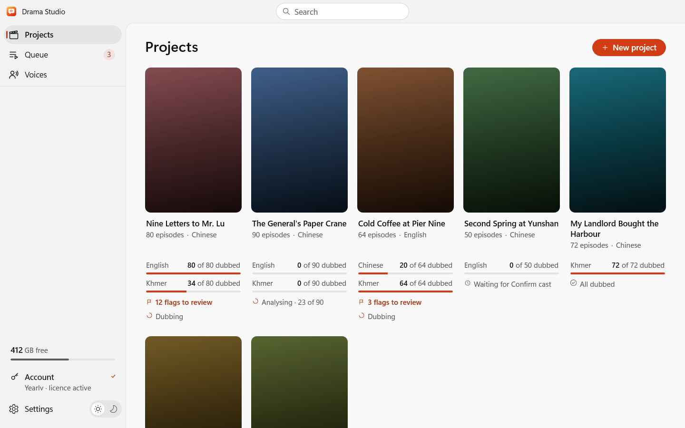
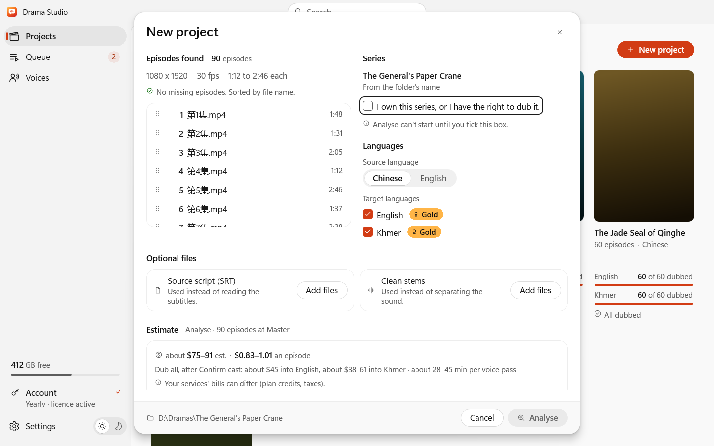
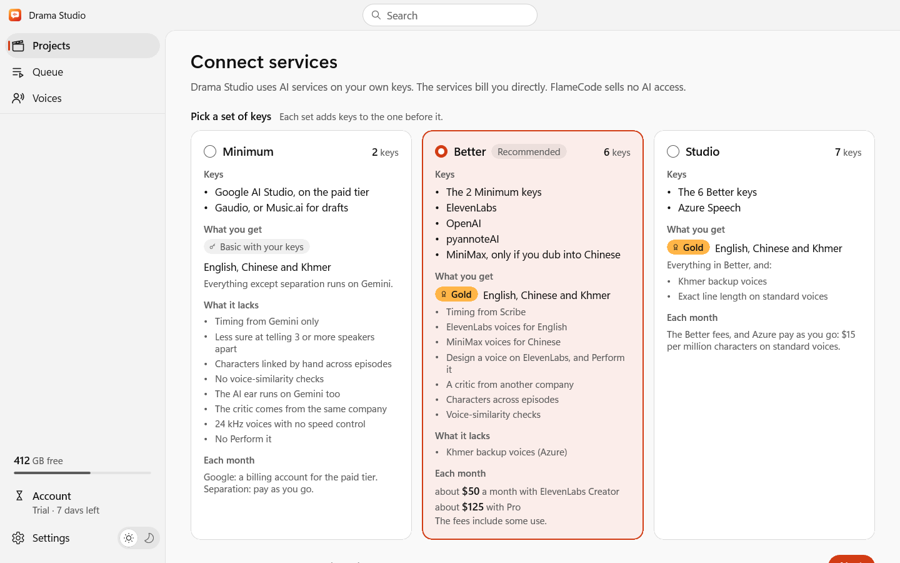
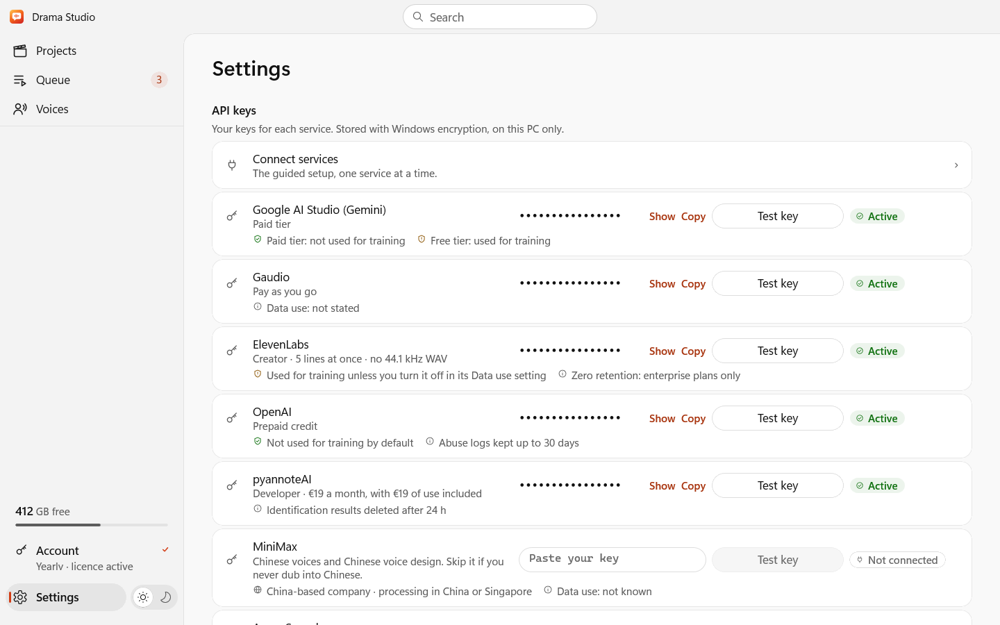
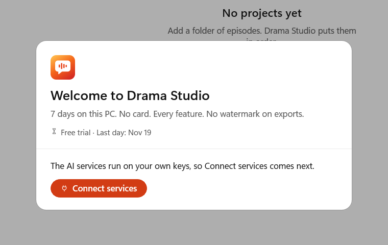
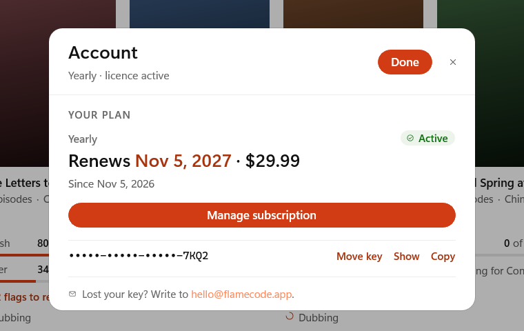

# Drama Studio

### AI dubbing for short dramas, on Windows

Dub the short dramas you own between Chinese, English and Khmer: 
one voice for each character, the original music and effects kept, and new subtitles. 
On your PC, with your own AI keys.

 

Windows 10 and 11 (64-bit) &nbsp;·&nbsp; 7-day free trial, no card &nbsp;·&nbsp; Your own AI keys &nbsp;·&nbsp; English&nbsp;·&nbsp;中&#8288;文&nbsp;·&nbsp;ខ្មែរ

  

<picture>
  <source media="(prefers-color-scheme: dark)" srcset="https://raw.githubusercontent.com/M4St3r0/drama-studio/main/assets/projects-dark.webp">
  
</picture>

 

> [!NOTE]
> **Drama Studio is in development and not available to download yet.** The pictures on this page come from the
> current build and show made-up sample projects. To hear when it's out, watch this repository's releases
> (**Watch › Custom › Releases**) or visit [flamecode.app](https://flamecode.app).

 

## ✨ What it does

**Drop in a whole series, confirm the cast, and get every episode back dubbed.**

- 🎬 **A whole series at once:** add the episodes from a folder on your PC. Drama Studio reads the episode numbers from the file names (第1集, EP01, S01E01…), puts them in order and shows any that are missing.
- 👥 **One voice per character:** it tells the characters apart across every episode and keeps each one's voice the same for the whole series.
- ✍️ **Lines that fit:** each line is adapted to its character and to the time it has on screen, checked by a second AI and translated back, with names and numbers kept right. Phone messages and other text on screen are translated too.
- 🎙️ **AI voices, never clones:** the voices come from the AI services you connect, or are new voices designed in Drama Studio. It never copies the actors' voices, or anyone else's.
- ⏱️ **In time with the picture:** each line starts, pauses and ends with the original.
- 🎵 **The original music and effects kept,** with the new voice sitting in the scene.
- 🔤 **New subtitles:** the old burned-in subtitles are blurred and readable new ones go on top, or export them as SRT, VTT or ASS.
- 🔎 **Checked before you publish:** likely problems are flagged first. Fix any line, and only what changed is redone.
- 💸 **The cost before you start:** an estimate of what the AI services will charge, and how long it takes, before every run; live spend while it runs; and a budget cap.
- 🔐 **Your keys stay on your PC,** protected by Windows. Every AI call goes from your PC straight to the service.

**Languages in 1.0:** Chinese → English, Chinese → Khmer, English → Chinese and English → Khmer. More languages come later, each once it passes its own quality checks.

 

## 🧭 A tour of the current build

### Projects

The page at the top: every series you're dubbing, most recently edited first.

- Each series shows its episodes and each language's progress: dubbing, flags to review, waiting for you to confirm the cast, or all dubbed.
- **New project** starts the next one, and the panel on the left shows the free space on the drive your projects use.

### New project

<picture>
  <source media="(prefers-color-scheme: dark)" srcset="https://raw.githubusercontent.com/M4St3r0/drama-studio/main/assets/newproject-dark.webp">
  
</picture>

- **Drop a folder or pick the files.** Episodes are put in order by the numbers in their names; a missing episode stays as a gap, and you can reorder or remove any of them.
- **Pick the languages** to dub into, and see the estimate before anything starts.
- **The rights box:** *"I own this series, or I have the right to dub it."* Nothing is analysed until it's ticked.

### Connect services

<picture>
  <source media="(prefers-color-scheme: dark)" srcset="https://raw.githubusercontent.com/M4St3r0/drama-studio/main/assets/connect-dark.webp">
  
</picture>

- **Three key sets** to choose from: *Minimum* (2 keys, pay as you go), *Better* (6 keys, recommended) and *Studio* (7 keys).
- Each service's plans, prices and **data use** are shown before you connect it, such as whether it trains on what you send.
- Each key is tested as you add it.

### Settings and your keys

<picture>
  <source media="(prefers-color-scheme: dark)" srcset="https://raw.githubusercontent.com/M4St3r0/drama-studio/main/assets/settings-dark.webp">
  
</picture>

- Each service's key, kept on this PC with Windows encryption and hidden until you choose **Show**.
- **Test key** checks it with the service. Beside each key: its status, your plan, and how the service uses your data.

### Account and the free trial

<table>
  <tr>
    <td width="50%" valign="top">
      <picture>
        <source media="(prefers-color-scheme: dark)" srcset="https://raw.githubusercontent.com/M4St3r0/drama-studio/main/assets/welcome-dark.webp">
        
      </picture>
      
<b>The 7-day trial:</b> every feature on this PC, with no card and no watermark on exports.

    </td>
    <td width="50%" valign="top">
      <picture>
        <source media="(prefers-color-scheme: dark)" srcset="https://raw.githubusercontent.com/M4St3r0/drama-studio/main/assets/account-dark.webp">
        
      </picture>
      
<b>Your licence key</b> works on one PC at a time. Move it to a new PC yourself, once every 7 days.

    </td>
  </tr>
</table>

 

## 🚀 How it works

| | | |
|:-:|:--|:--|
| **1** | **Connect your AI services** | Choose a key set and paste your own API keys. Drama Studio tests each one. |
| **2** | **Add a series** | Drop in its episodes from your PC, choose the languages, and confirm that you own the series or may dub it. |
| **3** | **Confirm the cast** | Drama Studio finds the characters and suggests a voice for each of them. You confirm the cast. |
| **4** | **Dub, check and export** | Every episode is dubbed and checked, flagged lines first. Export MP4 with burned-in subtitles, or SRT, VTT and ASS files. |

 

## 🔑 Your own AI keys

Drama Studio is sold as an app, by licence key. The AI work is done by the services **you** connect, on **your** accounts:

- **We don't sell AI.** FlameCode never sells access to AI services, credits or minutes, and holds no AI keys.
- **The services bill you directly,** under their own plans and terms. The app shows the estimated cost before every run.
- **Your videos and keys stay with you.** Projects stay on your PC. Each step sends what it needs from your PC straight to the service doing it. The app reaches FlameCode only for your licence and trial, purchases and updates.

| Key set | Keys | What it costs at the services |
|:--|:--|:--|
| **Minimum** | Google AI Studio (paid tier), and Gaudio or Music.ai | Pay as you go |
| **Better** ⭐ *recommended* | The Minimum keys, ElevenLabs, OpenAI, pyannoteAI, and MiniMax if you dub into Chinese | From about $50 a month, with some use included |
| **Studio** | The Better keys and Azure Speech | The Better fees, and Azure's pay as you go |

 

## 💎 Plans

**Not on sale yet.** These are the planned prices:

| | **Free trial** | **Monthly** | **Yearly** | **Lifetime** |
|:--|:-:|:-:|:-:|:-:|
| **Price** | **$0** | **$9.99** a month | **$29.99** a year | **$59.99** once |
| **Dubbing** | Every feature for 7 days on one PC | Unlimited with your own AI keys | Unlimited with your own AI keys | Unlimited with your own AI keys |
| **Good to know** | No card, no watermark | Cancel any time | About $2.50 a month | Paid once, no renewals |

Prices in US dollars, plus tax where it applies. Your AI services bill you separately, under their own plans. One licence key works on one PC at a time: move it to a new PC yourself, once every 7 days.

 

## 🛡️ Responsible use

- **AI voices only.** Drama Studio doesn't clone or imitate real people's voices, the actors' included.
- **Your own videos.** It imports video files from your PC only, never from links or streaming sites. Dub only the series you own or have the right to dub: Drama Studio asks you to confirm it for every series.
- **Characters, not people.** Telling the characters apart works only inside your own episodes. It never identifies anyone.
- **Label AI dubs** wherever a platform asks you to.

 

## 💻 Requirements

- **Windows 10** (version 2004 or newer) or **Windows 11**, 64-bit
- **Your own API keys** for the AI services you choose. Connect services shows what each one gives and costs.
- **An internet connection,** since the AI services work in the cloud

 

## ❓ FAQ

<b>When can I download it?</b>

 
When it's ready. Drama Studio launches once English, Chinese and Khmer all pass their quality checks. Watch this repository's releases (<b>Watch › Custom › Releases</b>) to hear when it's out.

<b>Does it clone voices?</b>

 
No. The voices come from the AI services you connect, or are new voices designed in Drama Studio. It never copies the actors' voices, or anyone else's.

<b>Which AI services does it work with?</b>

 
Google AI Studio (Gemini), ElevenLabs, OpenAI, pyannoteAI, MiniMax, Azure Speech, Gaudio and Music.ai, plus DeepSeek or Qwen as a budget translator between Chinese and English. You choose a key set when you start, and you can change it later.

<b>What will the AI services cost me?</b>

 
It depends on the services, their plans and how much you dub. The recommended Better set starts at about $50 a month in the services' own plans, which include some use. Before every run, Drama Studio shows the estimated cost and time, and you can set a budget cap.

<b>Can FlameCode see my videos or keys?</b>

 
No. Projects and videos stay on your PC, and your keys are kept there, protected by Windows. Each step goes from your PC straight to the service doing it, under your own account. The app reaches FlameCode only for your licence and trial, purchases and updates.

<b>Can I dub any video?</b>

 
Only series you own, or have the right to dub. Drama Studio works on video files on your PC, never on links, and asks you to confirm your rights for every series.

<b>Does it work on Mac?</b>

 
No. Drama Studio is a Windows app, for Windows 10 (version 2004 or newer) and Windows 11, 64-bit.

 

## 💬 Contact

- **Email:** [hello@flamecode.app](mailto:hello@flamecode.app)
- **Website:** [flamecode.app](https://flamecode.app)

 

<a href="https://flamecode.app">Website</a> &nbsp;·&nbsp; <a href="https://flamecode.app/terms/">Terms</a> &nbsp;·&nbsp; <a href="https://flamecode.app/privacy/">Privacy</a> &nbsp;·&nbsp; <a href="mailto:hello@flamecode.app">hello@flamecode.app</a>

Drama Studio is made by FlameCode. It is not affiliated with Google, ElevenLabs, OpenAI, Microsoft, MiniMax or any other AI service it connects to.

